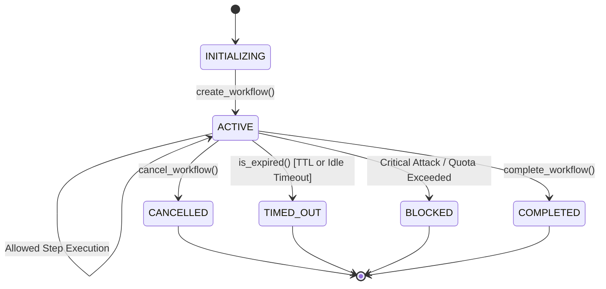

# Cross-Step Agent Security Specification & Threat Model

**LLMFirewall Core v1.2.0 — Phase 3 Specification**

---

## 1. Security Model & Identity Taxonomy

In autonomous AI agent systems, single-turn prompt filtering is insufficient. Multi-step reasoning loops, autonomous tool usage, retrieved RAG content, and dynamic decision-making introduce cross-step attack vectors. 

To prevent cross-tenant data leakage, privilege escalation, and confused-deputy attacks, LLMFirewall formally distinguishes between eight operational concepts:

| Identity / Concept | Origin & Source | Trust Level | Validation & Enforcement | Lifetime & Expiration |
| :--- | :--- | :--- | :--- | :--- |
| **Request Identity** (`request_id`) | Client HTTP header or generated UUID | Untrusted if client-supplied | Validated for string format & max length (128 chars); sanitization applied | Single HTTP request/response cycle |
| **Agent / Workflow Identity** (`agent_id`, `workflow_id`) | Orchestrator / Application server | **Authoritative** (trusted when established by application server) | Bound at workflow creation; verified via `ctx.assert_agent()` | Bound to workflow lifecycle (`ttl_seconds`) |
| **Tenant Identity** (`tenant_id`) | Authenticated session token (JWT/mTLS) from host API | **Authoritative & Immutable** | Bound at workflow creation; verified via `ctx.assert_tenant()`. Discrepancies raise `CrossTenantViolationError` | Strictly isolated; never crosses workflows |
| **Tool Identity** (`tool_name`) | Agent tool call declaration | Untrusted | Validated against workflow `allowed_tools` and `denied_tools` allowlists/blacklists | Per-invocation |
| **Security Context** (`WorkflowSecurityContext`) | LLMFirewall Core engine | Internal state | Managed in-memory with pluggable persistence; thread-safe locking | Subject to absolute TTL (`ttl_seconds`) and idle timeout (`idle_timeout_seconds`) |
| **Policy Authorization** (`ScopedPermission`) | Declarative application policy | **Authoritative** | Pre-execution evaluation: action whitelists, resource glob matching, clean workflow requirements | Static per workflow session |
| **Threat Observations** (`ThreatObservation`) | Detectors, RAG orchestrator, tool scanners | Internal security findings | Monotonically escalates workflow threat state (`CLEAN` -> `ELEVATED` -> `TAINTED` -> `CRITICAL`) | Retained in bounded FIFO window (50 items) |
| **Workflow Execution State** (`WorkflowStatus`) | CrossStepEnforcer lifecycle engine | Internal state | Deterministic state machine (`INITIALIZING`, `ACTIVE`, `CANCELLED`, `TIMED_OUT`, `BLOCKED`, `COMPLETED`) | Updated on every boundary transition |

> [!IMPORTANT]
> **The Untrusted Metadata Rule**:
> Agent-supplied parameters, prompt instructions, and tool outputs are **always untrusted**. An agent cannot declare its own tenant identity, escalate its permissions, or clear accumulated threat observations.

---

## 2. Cross-Step Architectural Flow & Trust Boundaries

LLMFirewall inspects interactions at five deterministic execution boundaries:

```text
1. User Request (Input) ──────► [BOUNDARY 1: Input Prompt Scan]
                                  fw.cross_step_enforcer.enforce_prompt()
                                        │ (Taint escalated if adversarial)
                                        ▼
2. RAG Knowledge Ingestion ───► [BOUNDARY 2: Retrieved Context Quarantine]
                                  fw.cross_step_enforcer.enforce_rag()
                                        │ (Quarantines injections; taints workflow)
                                        ▼
3. Agent Reason / Tool Call ──► [BOUNDARY 3: Pre-Execution Authorization]
                                  fw.check_tool_call() / @fw.protect_tool
                                        │ (Gated by tenant, taint state, and scoped permissions)
                                        ▼
                                  [Tool Executes ONLY If Authorized]
                                        │
                                        ▼
4. Tool Result ───────────────► [BOUNDARY 4: Tool Result Scan]
                                  fw.check_tool_result()
                                        │ (Taints workflow if sensitive data or secrets leak)
                                        ▼
5. Final Sanitized Output ────► [BOUNDARY 5: Output Generation Scan]
                                  fw.scan(output, direction="output")
```

### Trust Boundary Rules
1. **Prompt Boundary (Input)**: Inbound user text is evaluated for direct prompt injections, jailbreaks, and policy violations. Blocked inputs immediately mark the workflow `BLOCKED`.
2. **RAG Boundary (Retrieval)**: Retrieved external documents are treated as untrusted data (`InstructionAuthority.NONE`). Indirect prompt injections are quarantined before prompt assembly, escalating workflow threat state to `TAINTED`.
3. **Tool Call Boundary (Pre-Execution)**: Gating occurs *immediately before* the tool function executes. Denied operations raise `ToolAuthorizationError` and **never execute**.
4. **Tool Result Boundary (Post-Execution)**: Outputs returned by external APIs, databases, or subprocesses are inspected for leaked credentials or malicious payloads. Flagged results escalate workflow taint.
5. **Output Boundary (Generation)**: Model completions are scanned before returning to the end user.

---

## 3. Data Lifecycle, Concurrency & Zero-Retention Security

### Bounded In-Memory Cache & Storage
- `WorkflowContextManager` maintains an in-memory `OrderedDict` LRU cache capped at `max_in_memory` (default 1,000 entries).
- Workflows exceeding LRU limits are safely evicted to disk or backing storage via `BasePersistenceAdapter` (`PersistenceRecord`).
- Concurrency isolation is enforced with thread-safe recursive locks (`threading.RLock`) per manager instance.

### Zero-Retention Telemetry & Privacy
- **Raw User Prompts Are Never Stored in Workflow History**: The workflow audit trail stores SHA-256 cryptographic hashes (`content_hash`) of prompt and completion payloads.
- **Tool Arguments Are Scrubbed**: `tool_arguments_summary` records argument keys and type signatures (e.g. `{"user_id": "str", "count": "int"}`), completely preventing passwords, tokens, or PII from persisting in context dumps.
- **`safe_dict()`**: Generates exportable telemetry metrics scrubbing all payload substrings.

### Lifecycle & Eviction State Machine


- **Timeouts**: Enforces both absolute `ttl_seconds` (default 3600s) and inactivity `idle_timeout_seconds` (default 300s). Expired contexts reject all operations with `WorkflowExpiredError`.
- **Fail-Closed Storage Guarantee**: If a persistence adapter experiences an I/O error or database partition, `WorkflowSecurityError` is raised. The system **never falls back to permissive execution**.

---

## 4. Scoped Tool Permissions & Authorization Engine

Granular tool access is defined using `ScopedPermission`:

```python
from llmfirewall.workflow import ScopedPermission

doc_permission = ScopedPermission(
    tool_name="file_manager",
    allowed_actions=["read", "list"],
    denied_actions=["delete", "drop", "write"],
    allowed_resources=["/data/public/*", "/reports/*"],
    denied_resources=["/data/public/secrets/*", "/etc/*"],
    max_invocations=10,
    requires_clean_workflow=True,
)
```

### Authorization Gating Steps
1. **Lifecycle Check**: Reject if `CANCELLED`, `TIMED_OUT`, `BLOCKED`, or `COMPLETED`.
2. **Quota Checks**: Verify `step_count <= max_steps` and `tool_call_count <= max_tool_calls`.
3. **Allowlist / Denylist**: Check against global `allowed_tools` and `denied_tools`.
4. **Taint Gate**: If workflow `is_tainted`, block dangerous operations (`shell_exec`, `bash`, `rm`, `database_delete`, `send_email`, etc.).
5. **Scoped Action & Resource Matching**: Evaluate operation against permitted action whitelist/blacklist and resource glob patterns.
6. **Built-in Parameter Gating**: Real-time evaluation against path traversal (`..`, null bytes), command injection (`rm -rf`, `; bash`), and SSRF/cloud metadata access (`169.254.169.254`).
7. **Core Tool Engine Verification**: Invoke `fw.check_tool_call()`.

A denial at any step immediately raises `ToolAuthorizationError` and records the denial in the audit history.
