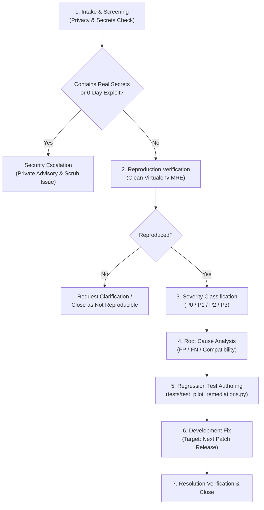

# LLMFirewall-Core: External Pilot Issue Triage Guide

This guide defines the standard operating procedure for reviewing, reproducing, classifying, and remediating issues reported by external pilot participants.

---

## 1. Core Principle: Reported Issue vs. Reproduced Defect

Maintainers must maintain a strict distinction between:
- **Participant-Reported Issue**: An unverified report or observation submitted via GitHub Issues. It may be due to local environment misconfiguration, third-party dependency drift, or unstated assumptions.
- **Reproduced Defect**: A confirmed bug that maintainers have independently reproduced in an isolated, clean virtual environment using a Minimal Reproducible Example (MRE) against `llmfirewall-core==1.4.0`.

**Only Reproduced Defects are counted in bug metrics and targeted for software remediation.**

---

## 2. Seven-Step Triage Workflow



### Step 1: Intake Screening & Privacy Scrubbing
- **Privacy Check**: Immediately inspect the issue text to confirm it does not contain real API keys, production customer records, or internal company hostnames.
- **Immediate Action**: If sensitive data is detected, redact the issue text immediately via GitHub Edit History and notify the participant.

### Step 2: Reproduction Verification
Maintainers must verify the issue using a clean isolated environment:
```bash
# Set up isolated verification environment
python3 -m venv /tmp/triage_env
source /tmp/triage_env/bin/activate
pip install --upgrade pip
pip install llmfirewall-core==1.4.0

# Install matching framework versions reported by participant
pip install [reported_framework]==[reported_version]

# Run the participant's MRE script
python triage_script.py
```
- If reproducible: Tag with appropriate `pilot-*` label and mark as verified.
- If not reproducible: Request environment details (`pip freeze`, OS architecture, Python micro-version) from the participant.

### Step 3: Severity Classification

| Priority | Severity Level | Definition & Criteria | SLA for Initial Response |
|---|---|---|:---:|
| **P0** | **Critical** | Crash in ASGI loop, unhandled exception in core `scan()`, or remote code execution bypass. | **< 12 Hours** |
| **P1** | **High** | High-frequency false positive blocking legitimate queries, or total framework integration failure on supported stack. | **< 24 Hours** |
| **P2** | **Medium** | Evasion on complex edge-case prompt, minor PII redaction distortion, or documentation discrepancy. | **< 48 Hours** |
| **P3** | **Low** | Ergonomic inconvenience, minor log formatting ambiguity, or cosmetic issue. | **< 72 Hours** |

### Step 4: Security Escalation Protocol
If an issue reports an unpatched, high-severity prompt injection bypass or secret leak:
1. Immediately transfer the report to a **GitHub Private Security Advisory**.
2. Remove exploit payloads from the public issue body.
3. Notify the participant that remediation is proceeding under responsible disclosure per [`SECURITY.md`](file:///Users/livesh/LLMFirewall/SECURITY.md).
4. Do not publish public patches until validated and coordinated.

### Step 5: False-Positive & False-Negative Analysis
- **For False Positives (`pilot-false-positive`)**:
  - Run `fw.trace_decision(query)` to identify which rule and detector triggered.
  - Check whether lowering individual detector weights or tightening regex boundaries resolves the FP without degrading adversarial recall on frozen Holdout datasets.
- **For False Negatives (`pilot-false-negative`)**:
  - Classify the evasion technique (e.g. homoglyph obfuscation, base64 wrapper, multi-turn roleplay).
  - Map against the multi-stage normalizer to determine if the active normalization engine or patch release addresses the pattern.

### Step 6: Remediation Ownership & Test Capture
1. Author an isolated reproduction test in `tests/` capturing the failure before modifying code.
2. Ensure `tests/test_secrets.py` SHA-256 (`d5ca47fd85349bf4ef6d7944ab9a9f131aa27877b58bb90b31532203d7420e41`) is never modified.
3. Ensure Holdout v1, v2, and v3 datasets are never altered.
4. Implement targeted fix in the main branch or scheduled patch release.

### Step 7: Resolution Verification & Closure
1. Re-run full test suite (`pytest -q`) and linter (`ruff check .`).
2. Verify that the reproduction test now passes.
3. Link the PR or commit to the pilot issue and update [`PARTICIPANT_TRACKING.md`](PARTICIPANT_TRACKING.md).
4. Thank the participant publicly (if they consented to acknowledgement).
