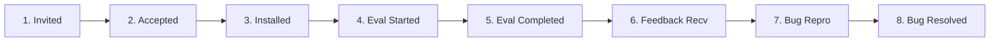

# LLMFirewall-Core: External Pilot Metrics & Evaluation Framework

This document defines the quantitative target metrics, cohort tracking schema, and evidence reconciliation protocol for the external developer pilot.

> [!IMPORTANT] Target Metrics Status
> **All metric targets defined below are prospective evaluation goals, NOT current results.**
> Internal tests, automated CI test runs, and maintainer evaluations are strictly barred from inflating participant counts or completion percentages.

---

## 1. Pilot Success Criteria & Benchmarks

| Evaluation Metric | Target Benchmark | Measurement Method | Target Objective |
|---|---:|---|---|
| **Independent Participants** | 5 – 10 developers | Verified independent external developers | Diverse representation across backend, GenAI, RAG, agent, and security roles. |
| **Installation Success Rate** | $\ge 80\%$ | Task A reported success rate | Confirms package builds and runs cleanly across OS/Python matrix without maintainer intervention. |
| **Completed Evaluations** | $\ge 5$ completed | Submitted `FEEDBACK_TEMPLATE.md` reports | Ensures sufficient depth of empirical feedback across Tasks A–F. |
| **Time to First Scan (TTFS)** | $< 10$ minutes | Self-reported participant elapsed minutes | Evaluates documentation clarity and quickstart friction. |
| **Reproducible Integration Bugs** | 100% triaged | GitHub issues / `BUG_REPORT_TEMPLATE.md` | All reported bugs logged, classified, and mapped to remediation issues. |
| **Critical Security Regressions** | 0 regressions | Zero unhandled crashes in production loops | No unexpected crashes, unhandled exceptions in ASGI loops, or bypasses introduced by integration. |
| **Actionable Feedback Reports** | $\ge 5$ reports | Detailed substantive feedback submissions | Concrete feature requests, ergonomics feedback, or edge-case discoveries. |

---

## 2. Participant Lifecycle & Funnel Tracking

To ensure rigorous, auditable tracking of external adoption without conflating internal testing with external developer engagement, the pilot explicitly tracks eight granular lifecycle stages:

### Stage Definitions:
1. **Invited**: Developer has been sent a personalized, maintainer-approved invitation.
2. **Accepted**: Developer has confirmed willingness to participate in the voluntary evaluation.
3. **Installed**: Developer has successfully executed `pip install llmfirewall-core==1.4.0` in their local environment.
4. **Evaluation Started**: Developer has begun executing Tasks B through F.
5. **Evaluation Completed**: Developer has completed the full evaluation workflow.
6. **Feedback Received**: Developer has submitted a completed `FEEDBACK_TEMPLATE.md` or `BUG_REPORT_TEMPLATE.md`.
7. **Bugs Reproduced**: Maintainers have independently replicated a reported issue in an isolated environment.
8. **Bugs Resolved**: Maintainers have authored, verified, and merged a remediation fix into the development branch.

### Funnel Metrics Tracking Table:

| Funnel Stage | Target Count | Current Count | Status / Notes |
|---|:---:|:---:|---|
| **1. Invited** | 5 – 10 | 0 | Awaiting explicit maintainer launch authorization |
| **2. Accepted** | 5 – 8 | 0 | Conversion target: $\ge 60\%$ of invited |
| **3. Installed** | 5 – 7 | 0 | Task A clean install target: $\ge 80\%$ of accepted |
| **4. Evaluation Started** | 5 – 6 | 0 | Progression target: $\ge 80\%$ of installed |
| **5. Evaluation Completed** | $\ge 5$ | 0 | Full workflow completion target: $\ge 5$ devs |
| **6. Feedback Received** | $\ge 5$ | 0 | Formal feedback reports received |
| **7. Bugs Reproduced** | All reported | 0 | 100% of reported issues triaged & reproduced |
| **8. Bugs Resolved** | All verified | 0 | Mapped to upcoming patch release remediation cycle |

---

## 3. Participant Cohort Tracking Ledger

This ledger records individual cohort progress. It will be populated as invitations are approved, sent, and returned:

| Participant ID | Engineering Persona | Target Environment / Stack | Outreach Date | Current Stage | Completion Date | Reported Issues | Continued Use Verdict |
|---|---|---|:---:|:---:|:---:|:---:|:---:|
| `DEV-EXT-01` | Python Backend | Ubuntu 22.04 / FastAPI / Uvicorn | *Pending Launch* | Not Started | — | — | — |
| `DEV-EXT-02` | Generative AI | macOS arm64 / OpenAI SDK / LiteLLM | *Pending Launch* | Not Started | — | — | — |
| `DEV-EXT-03` | RAG Systems | Debian 12 / LangChain / Chroma | *Pending Launch* | Not Started | — | — | — |
| `DEV-EXT-04` | AI Agents | Ubuntu 24.04 / MCP / Anthropic SDK | *Pending Launch* | Not Started | — | — | — |
| `DEV-EXT-05` | Application Security | macOS / DevSecOps / Policy-as-Code | *Pending Launch* | Not Started | — | — | — |
| `DEV-EXT-06` | Python Backend | RHEL 9 / Flask / Gunicorn | *Pending Launch* | Not Started | — | — | — |
| `DEV-EXT-07` | AI Agents | macOS arm64 / LangGraph / Tools | *Pending Launch* | Not Started | — | — | — |
| `DEV-EXT-08` | Generative AI | Windows WSL2 / Local Ollama / Streaming | *Pending Launch* | Not Started | — | — | — |

*Stage transitions: `Not Started` $\to$ `Invited` $\to$ `Accepted` $\to$ `Installed` $\to$ `Evaluation Started` $\to$ `Evaluation Completed` $\to$ `Feedback Received` (with `Bugs Reproduced` / `Bugs Resolved` tracking).*

---

## 4. Evidence Intake & Verification Protocol

When a developer submits feedback:
1. **Intake Validation**:
   - Verify that the feedback corresponds to a real independent environment.
   - Verify that no confidential or proprietary customer information was accidentally included.
2. **Issue Replication**:
   - If a bug or false positive is reported, reproduce it in an isolated virtual environment matching the tester's OS and Python version.
   - Add minimal reproduction tests to `tests/` if verified.
3. **Ledger Update**:
   - Record the completion date, issue references, and continued-use verdict in this tracking ledger.
4. **Sensitive Data Intake Audit**:
   - Confirm that submitted code snippets contain only synthetic or mock strings.
