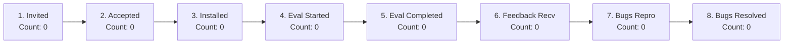

# LLMFirewall-Core: External Pilot Operational Dashboard

This document tracks the active lifecycle metrics, mathematical conversion rates, and operational status for the 10-developer external pilot.

> [!IMPORTANT] Initial Metric Baseline: Zero
> In accordance with strict evaluation integrity rules, **all initial operational counts are zero (0)**.
> No external developers have been contacted, invited, or recorded. Values will be updated strictly upon verified actions following explicit maintainer authorization.

---

## 1. Operational Lifecycle Metrics Dashboard

### Cumulative Funnel Summary:

| Funnel Lifecycle Stage | Target Count | Actual Count | Current Status |
|---|:---:|:---:|---|
| **1. Invited** | 10 | 0 | Awaiting maintainer launch authorization |
| **2. Accepted** | $\ge 6$ | 0 | Not started |
| **3. Installed** | $\ge 6$ | 0 | Not started |
| **4. Evaluation Started** | $\ge 5$ | 0 | Not started |
| **5. Evaluation Completed** | $\ge 5$ | 0 | Not started |
| **6. Feedback Received** | $\ge 5$ | 0 | Not started |
| **7. Bugs Reported** | — | 0 | Not started |
| **8. Bugs Reproduced** | All reported | 0 | Not started |
| **9. Bugs Resolved** | All verified | 0 | Not started |

---

## 2. Mathematical Metric Formulas & Definitions

To prevent ambiguity or inconsistent reporting, operational conversion metrics are calculated using the following exact formulas:

### 2.1 Invitation Acceptance Rate ($R_{\text{accept}}$)
The percentage of invited developers who voluntarily agree to evaluate the package:
$$\text{Invitation Acceptance Rate} = \left( \frac{\text{Accepted Count}}{\text{Invited Count}} \right) \times 100\%$$
- **Target**: $\ge 60\%$ (6 of 10 invited developers).

### 2.2 Installation Success Rate ($R_{\text{install}}$)
The percentage of accepted developers who install `llmfirewall-core==1.4.0` without blocking build or dependency errors:
$$\text{Installation Success Rate} = \left( \frac{\text{Installed Count}}{\text{Accepted Count}} \right) \times 100\%$$
- **Target**: $\ge 80\%$ (minimum acceptable packaging quality threshold).

### 2.3 Evaluation Completion Rate ($R_{\text{complete}}$)
The percentage of developers who started evaluation and completed the core tasks (Tasks A through F):
$$\text{Evaluation Completion Rate} = \left( \frac{\text{Evaluation Completed Count}}{\text{Evaluation Started Count}} \right) \times 100\%$$
- **Target**: $\ge 80\%$.

### 2.4 Feedback Submission Rate ($R_{\text{feedback}}$)
The percentage of completed evaluators who submit a structured feedback report via GitHub Issues:
$$\text{Feedback Submission Rate} = \left( \frac{\text{Feedback Received Count}}{\text{Evaluation Completed Count}} \right) \times 100\%$$
- **Target**: $100\%$ (all completed evaluations yield an issue or feedback form).

### 2.5 Bug Reproduction Rate ($R_{\text{repro}}$)
The proportion of participant-reported issues that maintainers successfully reproduce in isolated clean environments:
$$\text{Bug Reproduction Rate} = \left( \frac{\text{Bugs Reproduced Count}}{\text{Bugs Reported Count}} \right) \times 100\%$$
- **Target**: $100\%$ of incoming reports triaged and attempted for reproduction.

### 2.6 Bug Resolution Rate ($R_{\text{resolve}}$)
The percentage of confirmed, reproduced defects that have been fixed, verified with regression tests, and merged into the main branch or scheduled patch release:
$$\text{Bug Resolution Rate} = \left( \frac{\text{Bugs Resolved Count}}{\text{Bugs Reproduced Count}} \right) \times 100\%$$
- **Target**: $100\%$ of reproduced defects resolved prior to the next scheduled maintenance release.

---

## 3. Operational Cadence & Review Schedule

During the active 14-day evaluation window:
- **Daily**: Check GitHub Issues for new submissions tagged with `external-pilot` labels.
- **Within 24 Hours**: Acknowledge receipt of every reported issue and initiate isolated virtualenv reproduction per [`ISSUE_TRIAGE_GUIDE.md`](ISSUE_TRIAGE_GUIDE.md).
- **Weekly**: Update metric counts in this dashboard and update participant progress in [`PARTICIPANT_TRACKING.md`](PARTICIPANT_TRACKING.md).
- **End of Pilot**: Reconcile all metrics, compute final conversion rates, and produce the Phase 13 External Pilot Evaluation Summary Report.
