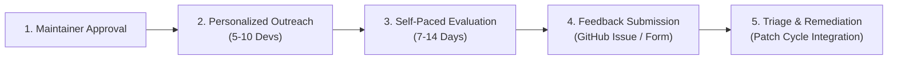

# LLMFirewall-Core: External Developer Pilot Overview

**Target Package**: `llmfirewall-core`
**Evaluation Version**: `v1.4.0` (Published Stable on PyPI)
**Package Distribution**: `llmfirewall-core==1.4.0`
**Program Status**: Prepared / Awaiting Maintainer Approval
**Time Commitment**: 30–45 minutes for core evaluation (7–14 day evaluation window)
**Cost**: 100% Free & Open-Source

---

## 1. Program Mission & Principles

The LLMFirewall-Core External Developer Pilot is an evidence-based technical evaluation designed to gather rigorous, unfiltered developer feedback on real-world installation, integration, detection effectiveness, developer ergonomics, and reliability.

This program is **not** a marketing campaign or promotional blitz. It is an engineering feedback mechanism to ensure that:
1. An independent Python developer can install and integrate `llmfirewall-core` without maintainer assistance.
2. Inbound prompt injection defenses and outbound secret leakage guards function reliably in real application environments.
3. Edge cases, false positives, false negatives, and ecosystem incompatibilities are transparently discovered and triaged for continuous release hardening and upcoming maintenance updates.

### Core Principles
- **No Production Secrets or Customer Data**: Testers must **never** share API keys, confidential data, or proprietary prompts. All exercises use synthetic or public mock data.
- **Empirical Transparency**: Both positive feedback and severe technical criticisms/bugs are logged verbatim in the feedback tracker.
- **Zero Telemetry / Zero Tracking**: The SDK operates entirely in-process. It makes zero network calls, contains zero analytics beacons, and communicates with zero external telemetry servers.
- **Respect for Developer Time**: Tasks are structured into self-contained modules that can be completed in 30–45 minutes.

---

## 2. Target Participant Personas

The pilot aims to recruit **5 to 10 independent developers** representing key ecosystem roles:

| Persona | Primary Focus & Interests | Typical Stack | Evaluation Value |
|---|---|---|---|
| **Python Backend Developer** | ASGI/WSGI middleware, latency, memory overhead, request lifecycle | FastAPI, Starlette, Flask, Django | Verifies perimeter defense without breaking API contracts or increasing p99 latency. |
| **Generative AI Developer** | Direct LLM SDK integration, streaming token safety, prompt formatting | OpenAI, Anthropic, LiteLLM, Ollama | Evaluates stream guardrails (`StreamingTextGuard`) and client pre-execution filters. |
| **RAG Systems Developer** | Document ingestion, poisoned vector chunks, indirect prompt injection | LangChain, LlamaIndex, Chroma, Qdrant | Evaluates context quarantine (`fw.context_orchestrator`) and delimiter escaping. |
| **AI Agent Developer** | Tool calling, autonomous action sandboxing, SSRF, command execution | LangGraph, AutoGen, CrewAI, MCP | Tests tool parameter validation (`fw.check_tool_call`), dangerous path/command blocking. |
| **Application Security Engineer** | Threat modeling, policy-as-code, audit logging, evasion resilience | Semgrep, OWASP LLM Top 10, DevSecOps | Audits deterministic policy rules, safe logging invariants (`safe_dict`), and bypass resistance. |

---

## 3. Evaluation Tasks Summary

Participants are guided through six structured tasks detailed in [`DEVELOPER_EVALUATION_GUIDE.md`](DEVELOPER_EVALUATION_GUIDE.md):

- **Task A — Clean Installation**: Install `llmfirewall-core` in an isolated virtual environment and verify importability.
- **Task B — First Security Scan**: Run benign and representative malicious inputs to verify deterministic decision semantics (`ALLOW` vs `BLOCK`).
- **Task C — Application Integration**: Integrate the perimeter guard into a small web application using `LLMFirewallASGIMiddleware` or function decorator `@fw.protect`.
- **Task D — Agent Tool Protection**: Test tool argument inspection (`fw.check_tool_call`) against SSRF and destructive shell commands.
- **Task E — PII Redaction & Output Inspection**: Verify the Redaction Invariant (`result.processed_text`), safe audit serialization (`result.safe_dict()`), and outbound secret leak interception.
- **Task F — Developer Experience & Performance**: Measure local scanning latency, evaluate error message clarity (`SecurityBlockError`), and document missing capabilities.

---

## 4. Pilot Workflow & Timeline

1. **Phase 1: Invitation (Day 0)**: Maintainer authorizes and delivers targeted invitation drafts to selected developers.
2. **Phase 2: Execution (Days 1–14)**: Participant conducts evaluation using [`DEVELOPER_EVALUATION_GUIDE.md`](DEVELOPER_EVALUATION_GUIDE.md) in their own environment.
3. **Phase 3: Feedback Intake (Days 7–14)**: Participant completes and submits [`FEEDBACK_TEMPLATE.md`](FEEDBACK_TEMPLATE.md) or [`BUG_REPORT_TEMPLATE.md`](BUG_REPORT_TEMPLATE.md).
4. **Phase 4: Synthesis & Triage (Day 15)**: Maintainers review issues, calculate success metrics, triage bugs, and incorporate feedback into scheduled patch and maintenance updates.

---

## 5. Security & Privacy Safeguards

LLMFirewall enforces strict privacy principles during the pilot:
1. **Local In-Process Execution**: All scanning, redaction, and policy enforcement occur strictly in local memory.
2. **Zero Inbound or Outbound Network Traffic**: `llmfirewall-core` does not open network sockets or send telemetry data.
3. **Safe Serialization Invariant**: When inspecting scan results for logging, the SDK provides `result.safe_dict()`, which automatically omits raw sensitive text and replaces secrets with `[OMITTED_FOR_SAFETY]`.
4. **No Proprietary Data Intake**: Feedback templates explicitly request that participants omit proprietary code, API tokens, or internal infrastructure details.

---

## 6. Associated Documentation Links

- [Developer Evaluation Guide](DEVELOPER_EVALUATION_GUIDE.md)
- [Feedback Submission Template](FEEDBACK_TEMPLATE.md)
- [Bug Report Template](BUG_REPORT_TEMPLATE.md)
- [Known Limitations & Architecture Boundaries](KNOWN_LIMITATIONS.md)
- [Pilot Success Metrics & Cohort Tracker](PILOT_METRICS.md)
