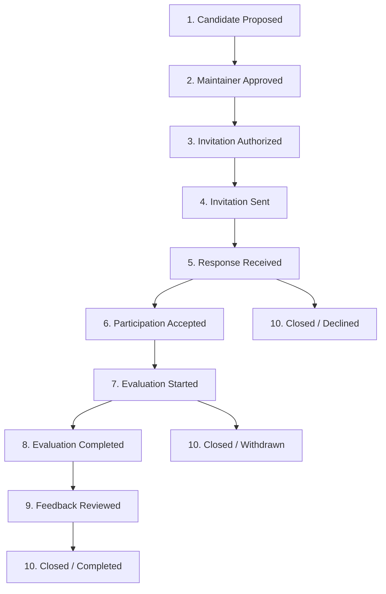

# LLMFirewall-Core: Private Pilot Response Tracker Template

> [!IMPORTANT] Local Privacy & Security Notice
> This document defines the schema for the maintainer's private local lifecycle tracking ledger.
> - **Zero Personal Contact Data**: No private email addresses, phone numbers, home addresses, or employer confidential records are stored here.
> - **Status Integrity**: In accordance with Phase 12.7 constraints, **no invitations have been sent, and all candidates remain at Stage 1 (Candidate Proposed)**.
> - **Local Storage**: This tracker must remain strictly local to the maintainer's workspace.

---

## 1. Ten Lifecycle Tracking Stages

To ensure auditable tracking from proposal to completion, every candidate progresses through exactly ten defined states:

### Stage Definitions:
1. **Stage 1: Candidate Proposed** — Candidate shortlisted and profile verified via Phase 12.6 audit.
2. **Stage 2: Maintainer Approved** — Maintainer has formally signed off on the candidate in the decision sheet.
3. **Stage 3: Invitation Authorized** — Invitation draft, personalized copy, and channel verified for outreach.
4. **Stage 4: Invitation Sent** — Maintainer has transmitted the personalized invitation via verified public channel.
5. **Stage 5: Response Received** — Candidate has responded to the initial contact.
6. **Stage 6: Participation Accepted** — Candidate has confirmed voluntary participation and completed Section A consent.
7. **Stage 7: Evaluation Started** — Candidate has created a clean virtualenv and confirmed package installation.
8. **Stage 8: Evaluation Completed** — Candidate has executed assigned tasks (Tasks A–F) within the 7–14-day window.
9. **Stage 9: Feedback Reviewed** — Candidate's `FEEDBACK_TEMPLATE.md` or issues triaged by maintainers.
10. **Stage 10: Closed / Completed** — Candidate cycle concluded (or gracefully closed/withdrawn).

---

## 2. Active Pilot Cohort Lifecycle Ledger

| Candidate ID | Persona Profile | Public GitHub Handle | Current Lifecycle Stage | Maintainer Approved | Invitation Authorized | Date Sent | Target Window (Days) | Linked Issues / PRs | Completion Date | Attribution Option | Notes / Action Items |
|:---:|---|---|:---:|:---:|:---:|:---:|:---:|:---:|:---:|:---:|---|
| `PILOT-001` | Python Backend | `@sondrelg` | **Stage 1: Candidate Proposed** | `Pending` | `Pending` | — | 7–14 | — | — | — | Primary candidate: ASGI middleware focus |
| `PILOT-002` | Python Backend | `@laurentS` | **Stage 1: Candidate Proposed** | `Pending` | `Pending` | — | 7–14 | — | — | — | Primary candidate: Rate limiting / Starlette focus |
| `PILOT-003` | Generative AI | `@yaacov` | **Stage 1: Candidate Proposed** | `Pending` | `Pending` | — | 7–14 | — | — | — | Primary candidate: Streaming token conversion focus |
| `PILOT-004` | Generative AI | `@Nayjest` | **Stage 1: Candidate Proposed** | `Pending` | `Pending` | — | 7–14 | — | — | — | Primary candidate: Multi-provider gateway focus |
| `PILOT-005` | RAG Systems | `@bhavnicksm` | **Stage 1: Candidate Proposed** | `Pending` | `Pending` | — | 7–14 | — | — | — | Primary candidate: Text chunking / RAG focus |
| `PILOT-006` | RAG Systems | `@davidmezzetti` | **Stage 1: Candidate Proposed** | `Pending` | `Pending` | — | 7–14 | — | — | — | Primary candidate: Vector embeddings / RAG focus |
| `PILOT-007` | AI Agents | `@aymeric-roucher` | **Stage 1: Candidate Proposed** | `Pending` | `Pending` | — | 7–14 | — | — | — | Primary candidate: Tool execution / Agent sandbox focus |
| `PILOT-008` | AI Agents | `@amidabuddha` | **Stage 1: Candidate Proposed** | `Pending` | `Pending` | — | 7–14 | — | — | — | Primary candidate: MCP server tool calling focus |
| `PILOT-009` | AppSec Engineer | `@leondz` | **Stage 1: Candidate Proposed** | `Pending (Conflict Review)` | `Pending` | — | 7–14 | — | — | — | Conflict Review Track: NVIDIA affiliation |
| `PILOT-010` | AppSec Engineer | `@asofter` | **Stage 1: Candidate Proposed** | `Pending (Conflict Review)` | `Pending` | — | 7–14 | — | — | — | Conflict Review Track: LLM Guard author |
| `RES-001` | AI Agents | `@ValentaTomas` | **Stage 1: Candidate Proposed** | `Pending` | `Pending` | — | 7–14 | — | — | — | Pre-qualified Reserve: E2B CTO (Agent sandboxing) |
| `RES-002` | AppSec Engineer | `@erickgalinkin` | **Stage 1: Candidate Proposed** | `Pending (Conflict Review)` | `Pending` | — | 7–14 | — | — | — | Conflict Review Reserve: NVIDIA NeMo Guardrails |
| `RES-003` | AI Agents / Sec | `@woop` | **Stage 1: Candidate Proposed** | `Pending` | `Pending` | — | 7–14 | — | — | — | Pre-qualified Reserve: Cleric CTO (Rebuff/Feast) |
| `RES-004` | RAG Systems | `@ZalaAvinash` | **Stage 1: Candidate Proposed** | `Pending (Score: 19/25)` | `Pending` | — | 7–14 | — | — | — | Below threshold (19/25); requires exception |

---

## 3. Allowed Field Values & Programmatic Invariants

To maintain clean programmatic reporting and prevent manual formatting corruption, maintainers must adhere to these standard values when updating this tracker:

1. **Current Lifecycle Stage**:
   - `Stage 1: Candidate Proposed`
   - `Stage 2: Maintainer Approved`
   - `Stage 3: Invitation Authorized`
   - `Stage 4: Invitation Sent`
   - `Stage 5: Response Received`
   - `Stage 6: Participation Accepted`
   - `Stage 7: Evaluation Started`
   - `Stage 8: Evaluation Completed`
   - `Stage 9: Feedback Reviewed`
   - `Stage 10: Closed / Completed`
   - `Stage 10: Closed / Declined`
   - `Stage 10: Closed / Withdrawn`

2. **Maintainer Approved**:
   - `Pending` | `Approved` | `Declined` | `Hold`

3. **Attribution Option**:
   - `Option 1 (Public Handle)` | `Option 2 (Pseudonymous)` | `Option 3 (Quoted)` | `Pending`
