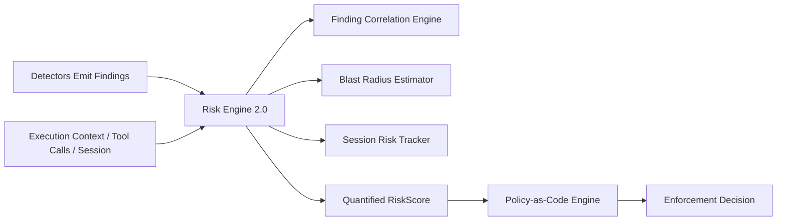

# Security Intelligence & Risk 2.0

LLMFirewall Core v1.1.0 upgrades the quantitative scoring architecture to **Security Intelligence & Risk 2.0**, introducing deterministic multi-stage attack correlation, dynamic environmental scoring, systemic blast radius estimation, and multi-turn session risk tracking with exponential temporal decay.

---

## 1. Architectural Foundations

In adherence to LLMFirewall's strict separation of concerns:
- **Detectors detect**: Produce atomic `Finding` objects without enforcement side-effects.
- **Risk Engine scores**: Calculates composite severity, per-category breakdowns, compound correlation, blast radius, and session accumulation.
- **Policy Engine decides**: Applies deterministic rules to select actions (`ALLOW`, `WARN`, `REDACT`, `BLOCK`).



---

## 2. Deterministic Finding Correlation

Attackers rarely rely on single atomic vectors. High-impact compromises combine prompt injection, tool abuse, credential leaks, and retrieval poisoning. The `FindingCorrelationEngine` correlates atomic findings deterministically to identify compound attack patterns.

### Compound Attack Taxonomy

| Attack Chain Type | Trigger Condition | Severity | Multiplier | Recommended Containment |
|---|---|---|---|---|
| `EXFILTRATION_CHAIN` | Prompt Injection / Jailbreak + Secret or PII leak | CRITICAL | 1.35x | Isolate session, mask credentials, terminate agent |
| `REMOTE_EXECUTION_CHAIN` | Injection / Jailbreak + Host tooling (`bash`, `exec`, `eval`) | CRITICAL | 1.40x | Deny host command execution, quarantine runner container |
| `INDIRECT_RAG_POISONING` | Untrusted retrieval source + System override | HIGH | 1.25x | Quarantine document chunk, re-index vector store |
| `PRIVILEGE_ESCALATION` | Role manipulation / Injection in elevated context (`admin`) | CRITICAL | 1.30x | Step down privilege token, mandate dual authorization |
| `MULTI_VECTOR_FLOOD` | $\ge 3$ distinct threat categories in one payload | HIGH | 1.20x | Trigger circuit breaker, block request batch |
| `ADJACENT_SPANS_COLLUSION` | Distinct threat vectors in proximate spans ($\le 50$ chars) | HIGH | 1.15x | Deep scan surrounding lexical window, redact segment |

### Programmatic Usage

```python
from llmfirewall import Severity, ThreatType, Finding
from llmfirewall.risk import RiskEngine

engine = RiskEngine()

findings = [
    Finding(
        detector_name="injection_detector",
        threat_type=ThreatType.PROMPT_INJECTION,
        description="Override system guardrails",
        severity=Severity.HIGH,
        confidence=0.90,
    ),
    Finding(
        detector_name="secret_detector",
        threat_type=ThreatType.SECRET,
        description="AWS Secret Key disclosure",
        severity=Severity.CRITICAL,
        confidence=0.95,
    ),
]

# Run correlation
report = engine.correlate(findings)
print(f"Is compound attack: {report.is_compound_attack}")
print(f"Correlation multiplier: {report.correlation_multiplier}x")
for chain in report.chains:
    print(f"Chain: {chain.name} ({chain.chain_type.value}) - Mitigation: {chain.mitigation}")
```

---

## 3. Context-Aware Dynamic Scoring

Scores can be dynamically scaled based on caller identity, runtime environment, and network topology:

- **Environmental Multipliers**:
  - `production`: 1.15x
  - `staging`: 1.00x
  - `development`: 0.85x
- **Trust Boundary Traversal**: 1.20x multiplier when untrusted external input crosses internal trust boundaries.
- **Asset Criticality**: Linear scaling based on target asset importance ($0.8 + 0.4 \times \text{criticality}$).

```python
risk = engine.evaluate(
    findings,
    context={
        "environment": "production",
        "trust_boundary_traversed": True,
        "asset_criticality": 1.0,
        "user_role": "admin",
    },
)

print(f"Contextual Score: {risk.score} (Max Severity: {risk.max_severity.value})")
print(f"Blast Radius metadata: {risk.metadata.get('blast_radius')}")
```

---

## 4. Blast Radius Estimation

The `BlastRadiusEstimator` quantifies systemic risk exposure:
- **Reachable Systems**: Microservices, tools, host operating system planes.
- **Exposed Data Classifications**: API credentials, tokens, PII, financial information.
- **Privilege Escalation Risk**: Evaluates administrative tokens and dangerous host tooling.
- **Prescribed Containment**: Actionable steps for SOC and automated incident response pipelines.

```python
blast_report = engine.estimate_blast_radius(
    findings,
    context={"tool_name": "db_query", "environment": "production", "user_role": "admin"}
)
print(f"Blast Score: {blast_report.score} ({blast_report.impact_level.value})")
print(f"Reachable Systems: {blast_report.reachable_systems}")
print(f"Containment Steps: {blast_report.containment_steps}")
```

---

## 5. Multi-Turn Session Risk & Temporal Decay

Attackers probing defenses often distribute low-severity probes across multiple turns to avoid triggering single-turn thresholds ("low-and-slow" attacks).

The `SessionRiskTracker`:
1. Maintains thread-safe turn history per session ID.
2. Applies exponential decay over time: $R(t) = R_0 \cdot e^{-\lambda \Delta t}$ with a configurable half-life (default 300s).
3. Detects repeated low/moderate violations accumulating above threshold and triggers `is_probe_attack=True` with `CRITICAL` alert level.

```python
# Track turns across a chat session
session_id = "user-sess-889"

summary = engine.track_session(
    session_id=session_id,
    findings=turn_findings,
    risk_score=0.45,
)

print(f"Turns: {summary.total_turns}")
print(f"Decayed Session Risk: {summary.decayed_score}")
print(f"Probe Attack Detected: {summary.is_probe_attack}")
print(f"Alert Level: {summary.alert_level.value}")
```

---

## 6. Cryptographic Baseline Snapshots & Regressions

Baseline posture snapshots can be computed and diffed to detect security regressions in CI/CD:

```python
# Baseline snapshot before deployment
baseline = engine.snapshot()

# Compare against new snapshot
current = engine.snapshot()
diff = engine.diff(baseline, current)

if diff.regressions:
    print(f"Detected {len(diff.regressions)} risk regressions!")
```
